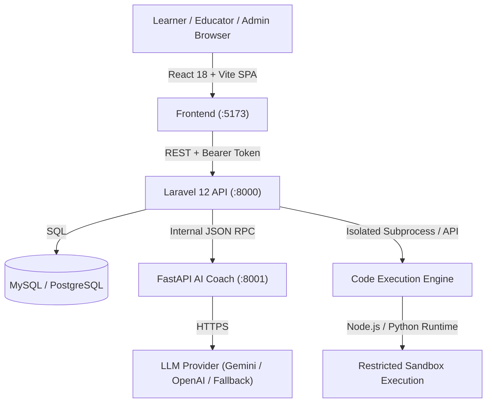

# BugQuest AI — System Architecture

## 1. Architectural Philosophy

BugQuest AI is structured as a modular, decoupled monorepo separating user interface, core business logic and persistence, isolated execution, and AI coaching.

---

## 2. Service Boundaries & Responsibilities

### 2.1 Frontend (`frontend/`)
- **Technology**: React 18, TypeScript (strict mode), Vite, Tailwind CSS, Monaco Editor.
- **Responsibility**: Rendering UI states, managing local state via React Context and TanStack Query, syntax highlighting and code editing via Monaco Editor, client-side input validation, and rendering live assessment feedback.
- **Security Boundary**: Never receives hidden test case inputs, expected outputs, or AI system prompt keys.

### 2.2 Backend (`backend/`)
- **Technology**: PHP 8.2+, Laravel 12, Laravel Sanctum, Eloquent ORM.
- **Responsibility**:
  - Source of truth for users, challenges, submissions, skill evidence, recommendations, and reports.
  - Role-based access control (Learner, Educator, Administrator).
  - Rate limiting (e.g., max 15 submissions/min, 20 AI hint requests/min).
  - Multi-provider code judge dispatching (isolated subprocess, Piston, or Judge0).
  - Skill intelligence aggregation and deterministic recommendations generation.
  - Cryptographic token generation and lifecycle management for consent-controlled reports.

### 2.3 AI Coaching Service (`ai-service/`)
- **Technology**: Python 3.10+, FastAPI, Pydantic v2, HTTPX.
- **Responsibility**:
  - Receiving sanitized challenge statements, public examples, and compiler/runtime diagnostics.
  - Applying versioned pedagogical prompt templates across 4 progressive tiers (`nudge`, `direction`, `debugging_guidance`, `detailed_explanation`).
  - Enforcing strict JSON schema validation on LLM output.
  - Guardrail defenses against prompt injection embedded in student source code or error logs.
  - Graceful deterministic fallback when external LLM providers are unavailable or fail validation.

### 2.4 Code Assessment Isolation (`backend/app/Services/CodeJudgeService.php`)
- **Architecture**:
  - **Local Isolated Sub-process**: Executes Node.js (`.cjs`) and Python scripts via Symfony Process in isolated temporary directories with strict per-test timeouts (default 2000ms) and standard I/O redirection.
  - **Remote Adapter Capabilities**: Standardized adapters for Judge0 API and Piston API for production containerized clusters.
  - **Safety Guarantees**: Hidden test cases remain in the database layer and are piped into execution scripts without ever being exposed over the HTTP API.

---

## 3. Core Request Flows

### 3.1 Code Submission & Assessment Lifecycle
1. Learner clicks "Run & Submit Solution" in Monaco Editor.
2. Frontend sends `POST /api/submissions` with `{ challenge_id, language, code, idempotency_key }`.
3. Laravel verifies Sanctum token, applies rate limiting (`throttle:15,1`), and checks for duplicate submission within 10s.
4. `CodeJudgeService` fetches public and hidden test cases from the database.
5. In an isolated sub-process, each test case input is piped into the code with a strict timeout.
6. The service evaluates stdout against `expected_output` (supporting JSON normalization and whitespace trimming).
7. If any test fails:
   - For public tests: Actual vs. expected output is logged for student review.
   - For hidden tests: Only an edge-case hint is recorded; raw test data is never leaked.
8. Submission is stored with execution metrics.
9. `SkillIntelligenceService` updates empirical evidence counts for all related topic tags.
10. Sanitized submission results are returned to the client.

### 3.2 Progressive AI Debugging Coaching Lifecycle
1. Learner requests assistance by selecting a hint tier (e.g., `nudge` or `direction`).
2. Frontend calls `POST /api/ai/hint`.
3. Laravel retrieves the challenge metadata and submission diagnostics (excluding hidden tests).
4. Laravel proxies the sanitized request to FastAPI (`http://127.0.0.1:8001/v1/coach/hint`).
5. FastAPI formats the pedagogical prompt and invokes the LLM adapter with schema constraints.
6. LLM response is parsed into `HintResponse` Pydantic model (`summary`, `likely_issue`, `hint_level`, `explanation`, `next_steps`, `concept_tags`, `confidence`).
7. Result is persisted in `ai_coaching_sessions` table and returned to student.

### 3.3 Consent-Controlled Report Sharing Lifecycle
1. Learner clicks "Create Share Link" on their Readiness Report.
2. Learner toggles privacy scopes (e.g., `allow_diagnostics: true`, `allow_code_samples: false`, `expires_days: 30`).
3. Laravel generates a 64-character unguessable cryptographic token (`bin2hex(random_bytes(32))`) and persists it in `report_share_tokens`.
4. Anyone with the share URL can access `GET /api/reports/shared/{token}` without authentication.
5. Laravel verifies that the token exists, is not revoked, and is not expired; then returns only consented fields.
6. If the learner clicks "Revoke", the token is marked `is_revoked = true`; subsequent access attempts strictly return `404 Not Found`.
