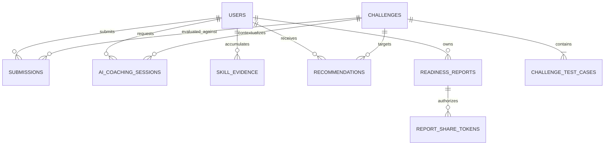

# BugQuest AI — Database Schema & Data Architecture

## 1. Overview

BugQuest AI uses a relational schema designed for MySQL 8 and PostgreSQL 15, managed via Laravel 12 migrations and seeders. Foreign key constraints, unique indexes, and audit timestamps ensure consistency and data integrity.

---

## 2. Entity-Relationship Diagram

---

## 3. Core Tables Reference

### 3.1 `users`
Represents learners, educators, and administrators.
- `id` (bigint unsigned, PK)
- `name` (string)
- `email` (string, unique)
- `password` (string, hashed bcrypt)
- `role` (enum: `learner`, `educator`, `admin`, default `learner`)
- `bio` (text, nullable)
- `target_role` (string, nullable, e.g., 'Full-Stack Developer')
- `preferred_language` (string, default 'javascript')
- `email_verified_at` (timestamp, nullable)
- `created_at`, `updated_at` (timestamps)

### 3.2 `challenges`
Defines coding problems and constraints.
- `id` (bigint unsigned, PK)
- `slug` (string, unique, indexed)
- `title` (string)
- `difficulty` (enum: `beginner`, `intermediate`, `advanced`, indexed)
- `description` (text)
- `input_spec` (text, nullable)
- `output_spec` (text, nullable)
- `constraints` (json)
- `public_examples` (json)
- `starter_code` (json: `{ javascript: "...", python: "..." }`)
- `supported_languages` (json: `["javascript", "python"]`)
- `topics` (json: `["arrays", "hash_maps"]`)
- `hints` (json, nullable)
- `editorial` (text, nullable)
- `time_limit_ms` (int, default 2000)
- `memory_limit_mb` (int, default 128)
- `is_active` (boolean, default true)
- `order_index` (int, default 0)

### 3.3 `challenge_test_cases`
Holds public and private validation criteria.
- `id` (bigint unsigned, PK)
- `challenge_id` (FK -> `challenges.id`, cascade on delete)
- `input` (text)
- `expected_output` (text)
- `is_hidden` (boolean, default false, indexed)
- `explanation` (text, nullable)
- `order_index` (int, default 0)

> **Security Rule**: Rows with `is_hidden = true` are strictly isolated inside the backend judge service and are NEVER returned in API responses or sent to LLM providers.

### 3.4 `submissions`
Records every student evaluation attempt.
- `id` (bigint unsigned, PK)
- `user_id` (FK -> `users.id`, cascade on delete)
- `challenge_id` (FK -> `challenges.id`, cascade on delete)
- `language` (string: `javascript`, `python`)
- `code` (mediumText)
- `status` (enum: `pending`, `running`, `accepted`, `wrong_answer`, `time_limit_exceeded`, `runtime_error`, `compilation_error`, `judge_unavailable`)
- `pass_count` (int, default 0)
- `total_count` (int, default 0)
- `execution_time_ms` (float, nullable)
- `memory_kb` (int, nullable)
- `error_output` (text, nullable)
- `public_test_results` (json, nullable)
- `judge_provider` (string: `isolated_sandbox`, `piston`, `judge0`)
- `idempotency_key` (string, nullable, indexed)

### 3.5 `skill_evidence`
Maintains empirical skill scores by topic for each learner.
- `id` (bigint unsigned, PK)
- `user_id` (FK -> `users.id`, cascade on delete)
- `topic` (string, indexed)
- `score` (int, 0-100)
- `proficiency_level` (enum: `developing`, `demonstrating_progress`, `consistent`)
- `challenges_attempted` (int, default 0)
- `challenges_passed` (int, default 0)
- `total_submissions` (int, default 0)
- `hints_requested_count` (int, default 0)
- `last_assessed_at` (timestamp, nullable)
- `diagnostic_history` (json, records pass ratios and execution timestamps)
- Unique constraint: `[user_id, topic]`

### 3.6 `recommendations`
Stores personalized next-step challenge suggestions.
- `id` (bigint unsigned, PK)
- `user_id` (FK -> `users.id`, cascade on delete)
- `challenge_id` (FK -> `challenges.id`, cascade on delete)
- `topic` (string)
- `reason` (string)
- `confidence` (float, default 0.85)
- `is_completed` (boolean, default false)
- `is_dismissed` (boolean, default false)

### 3.7 `readiness_reports` & `report_share_tokens`
Houses compiled candidate dossiers and revocable access tokens.
- `readiness_reports`:
  - `id` (bigint unsigned, PK)
  - `user_id` (FK -> `users.id`, cascade on delete)
  - `report_uuid` (uuid, unique, indexed)
  - `title` (string)
  - `overall_readiness_score` (int)
  - `readiness_level` (string)
  - `summary` (text)
  - `methodology_notes` (text)
  - `limitations_disclaimer` (text)
  - `skill_breakdown` (json)
  - `verified_evidence_count` (int)
  - `generated_at` (timestamp)
- `report_share_tokens`:
  - `id` (bigint unsigned, PK)
  - `readiness_report_id` (FK -> `readiness_reports.id`, cascade on delete)
  - `share_token` (string 64, unique, indexed)
  - `is_revoked` (boolean, default false, indexed)
  - `allow_code_samples` (boolean, default false)
  - `allow_diagnostics` (boolean, default true)
  - `views_count` (int, default 0)
  - `last_viewed_at` (timestamp, nullable)
  - `expires_at` (timestamp, nullable)

---

## 4. Indexing & Retention Strategy

- **Lookup Efficiency**: Compound index on `[user_id, topic]` in `skill_evidence`, `[challenge_id, is_hidden]` in `challenge_test_cases`, and single unique index on `share_token` in `report_share_tokens`.
- **Soft Deletion & Revocation**: Tokens use boolean flag `is_revoked` for instant invalidation without breaking relational logs.
